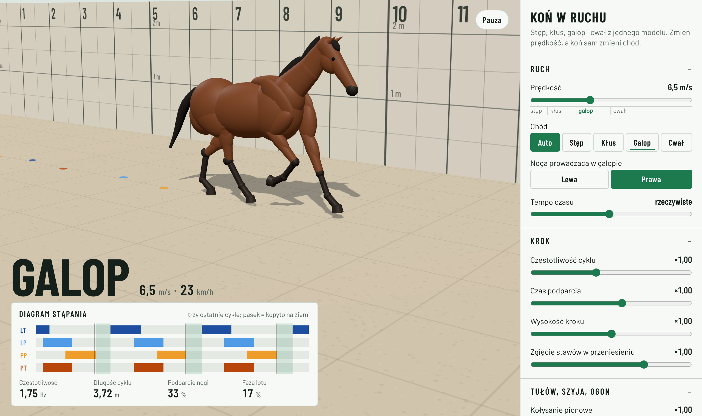

# Koń w ruchu

Interaktywna symulacja 3D, która pokazuje, jak koń porusza się w czterech chodach: stępie, kłusie, galopie i cwale. Działa w przeglądarce, bez instalacji i bez logowania.

**[Otwórz symulację](https://kobr2000.github.io/kon-w-ruchu/)**

[](https://kobr2000.github.io/kon-w-ruchu/)

## Do czego to służy

Symulacja nadaje się do prezentacji, szkoleń i materiałów edukacyjnych: w kilka sekund widać, czym różnią się chody konia i co się zmienia, gdy koń przyspiesza. Można ją pokazać na spotkaniu z rzutnika, wysłać jako link albo otworzyć na telefonie.

## Jak zacząć

1. Otwórz [symulację](https://kobr2000.github.io/kon-w-ruchu/).
2. Przesuń suwak **Prędkość**. Koń sam zmieni chód: około 2 m/s przechodzi ze stępa w kłus, około 5 m/s w galop, a między 7 a 10,5 m/s płynnie w cwał.
3. Przeciągnij scenę myszą lub palcem, żeby obejrzeć konia z innej strony. Kółko myszy przybliża.

Przycisk **Pauza** zatrzymuje ruch, a suwak **Tempo czasu** zwalnia go nawet dwudziestokrotnie, co pozwala prześledzić pojedynczy krok.

## Co można ustawić

| Sekcja panelu | Co zmienia |
| --- | --- |
| Ruch | Prędkość (0–18 m/s, czyli do 65 km/h), chód wybierany automatycznie lub ręcznie, noga prowadząca w galopie, tempo czasu |
| Krok | Częstotliwość kroków, czas, przez który kopyto stoi na ziemi, wysokość kroku, zgięcie stawów |
| Tułów, szyja, ogon | Kołysanie, pochylanie i przechył tułowia, praca grzbietu, ruch głowy, uniesienie ogona |
| Własny wzorzec stąpania | Moment postawienia każdej nogi osobno, z gotowymi ustawieniami, na przykład inochód |
| Budowa konia | Wysokość w kłębie (100–190 cm), długość nóg i tułowia, masywność, maść |
| Widok | Pięć ustawień kamery, podgląd szkieletu, ślady kopyt, ślad ruchu w stylu chronofotografii |

Skróty klawiszowe: `Spacja` — pauza, `←` `→` — prędkość, `0`–`4` — wybór chodu.

## Jak czytać diagram stąpania

Diagram w lewym dolnym rogu pokazuje trzy ostatnie cykle ruchu. Każdy wiersz to jedna noga: LT i LP to lewa tylna i lewa przednia, PP i PT to prawa przednia i prawa tylna. Kolorowy pasek oznacza, że kopyto stoi na ziemi. Zielone pionowe pasy to faza lotu, czyli chwile, w których żadne kopyto nie dotyka podłoża. Te same kolory mają ślady kopyt na torze.

Pod diagramem widać cztery liczby: częstotliwość cyklu, długość cyklu, jaką część cyklu noga stoi na ziemi oraz udział fazy lotu.

## Co warto wiedzieć przed użyciem

- **To model poglądowy, nie pomiarowy.** Pokazuje poprawną kolejność stawiania nóg i ogólny charakter każdego chodu. Wartości liczbowe (częstotliwości, długości cyklu, progi zmiany chodu) są typowe dla konia o wysokości 160 cm, ale nie zostały zweryfikowane ze źródłami naukowymi. Nie należy opierać na nich decyzji weterynaryjnych ani treningowych.
- **Ruch jest wyliczany, nie nagrany.** Symulacja nie korzysta z nagrań prawdziwych koni. Kopyta w podparciu stoją w miejscu bez poślizgu, a kąty stawów i ruch tułowia wynikają z uproszczonych obliczeń.
- **Znane niedoskonałości.** Przy ostrym hamowaniu z cwału kopyto potrafi na moment oderwać się od ziemi o około centymetr. Przy prędkości zero koń zatrzymuje się w pół kroku, zamiast ustawić nogi równo.
- **Przeglądarki.** Symulację sprawdzono w przeglądarce Chromium (na niej opierają się Chrome i Edge). W aktualnych wersjach Firefoksa i Safari powinna działać, ale nie była tam testowana. Wymaga włączonej grafiki WebGL 2.

## Prywatność i praca bez internetu

Strona nie zbiera żadnych danych: nie ma plików cookie, analityki ani formularzy, a wszystkie obliczenia odbywają się w przeglądarce. Jedyne połączenie zewnętrzne to pobranie czcionek interfejsu z Google Fonts.

Symulacja działa też bez internetu. Wystarczy pobrać repozytorium (przycisk **Code**, potem **Download ZIP**), rozpakować je i otworzyć plik `index.html`. Czcionki zostaną wtedy zastąpione systemowymi.

## Dla zespołu technicznego

Projekt to czysty JavaScript bez kroku budowania i bez instalowania zależności.

| Plik | Zawartość |
| --- | --- |
| `index.html` | Strona i style |
| `js/horse-model.js` | Model ruchu: wzorce stąpania, kinematyka odwrotna kończyn, ruch tułowia. Nie ma zależności, działa także w Node |
| `js/horse-app.js` | Scena 3D, panel parametrów, diagram stąpania |
| `js/three.min.js` | Biblioteka Three.js r170 z OrbitControls, spakowana do jednego pliku |

Model można uruchomić bez przeglądarki:

```js
const HorseModel = require('./js/horse-model.js');
const model = new HorseModel({ height: 1.6 }, { speed: 6 });
for (let i = 0; i < 120; i++) model.update(1 / 60);
console.log(model.info.gaitName, model.info.f, model.info.stride);
```

## Licencja

Kod jest udostępniony na licencji MIT — szczegóły w pliku [LICENSE](LICENSE). Biblioteka Three.js również jest na licencji MIT; jej treść znajduje się w pliku [THIRD_PARTY_LICENSES.md](THIRD_PARTY_LICENSES.md).

## In English

An interactive 3D simulation of horse gaits (walk, trot, canter, gallop) that runs in the browser. Move the speed slider and the horse changes gait on its own. The interface is in Polish. It is an illustrative kinematic model, not a measurement tool.
